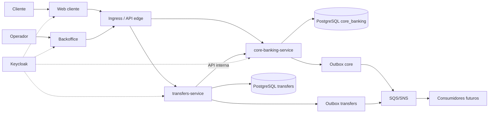
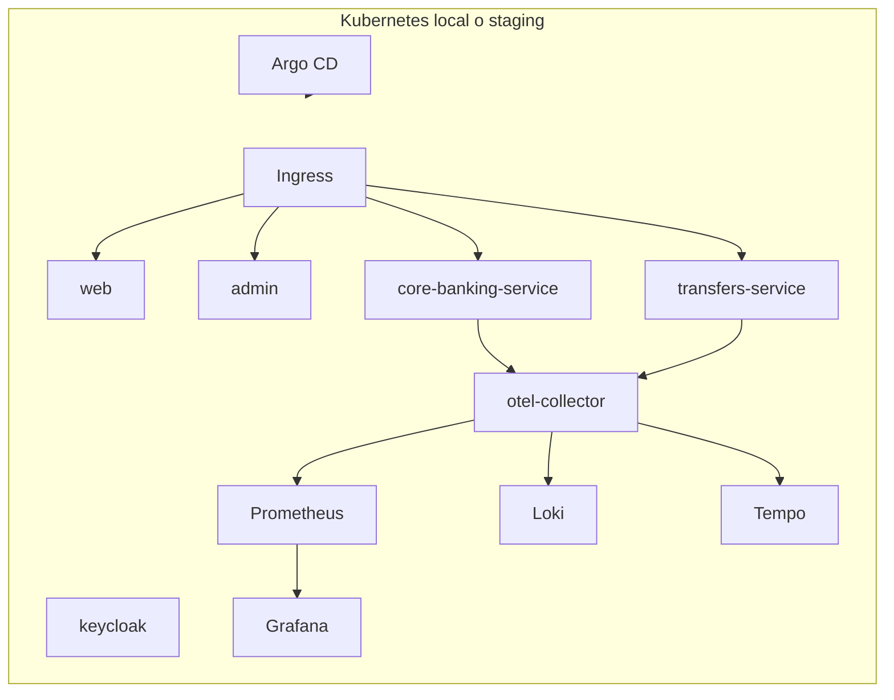

# Arquitectura — vista general

## 1. Objetivo

Describir la arquitectura objetivo del MVP: dos microservicios de negocio, dos frontends, una
plataforma local con Floci y Kubernetes, y una plataforma cloud production-like.

## 2. Principios

1. **Dos servicios de negocio al inicio.** No se parte de una constelación de microservicios.
2. **Cada servicio es dueño de sus datos.** No hay base de datos compartida.
3. **El dinero se mueve dentro de un solo servicio.** El asiento contable es atómico.
4. **Contratos primero.** OpenAPI y eventos se definen antes de implementar.
5. **Asincronía para efectos secundarios.** Outbox + cola; no se publica dentro de la transacción.
6. **Idempotencia en todos los bordes.** Reintentar nunca duplica dinero.
7. **GitOps y artefactos inmutables.** La misma imagen se promueve por digest.
8. **Observabilidad desde el walking skeleton.** No se agrega al final.

## 3. Diagrama de contexto

## 4. Componentes

| Componente | Tipo | Responsabilidad |
| --- | --- | --- |
| `web` | Aplicación cliente | Login, cuentas, movimientos, transferencias, extractos. |
| `admin` | Aplicación de backoffice | Operación, auditoría, congelamiento, ajustes. |
| `core-banking-service` | Microservicio | Clientes, cuentas, ledger, saldos, extractos. |
| `transfers-service` | Microservicio | Transferencias, idempotencia, orquestación, outbox. |
| `Keycloak` | Infraestructura | Identidad OIDC/OAuth2, roles y clientes. |
| PostgreSQL `core_banking` | Base de datos | Datos de core banking. |
| PostgreSQL `transfers` | Base de datos | Datos de transferencias. |
| Redis | Infraestructura | Cache, sesiones, rate limiting. |
| SQS/SNS (Floci) | Mensajería | Eventos de dominio. |
| S3 (Floci) | Almacenamiento | Extractos, comprobantes, exports. |
| Floci | Emulador local | Servicios AWS locales. |
| kind / k3d | Kubernetes local | Ejecución de servicios y plataforma. |
| Argo CD | GitOps | Sincronización de Kubernetes con Git. |
| Prometheus/Grafana/Loki/Tempo | Observabilidad | Métricas, dashboards, logs y trazas. |

## 5. Comunicación

### Síncrona

- Cliente → `transfers-service` para iniciar transferencias.
- Cliente → `core-banking-service` para lecturas de cuentas y movimientos.
- `transfers-service` → `core-banking-service` para el posting atómico.

### Asíncrona

- `transfers-service` publica `transfer.completed.v1` / `transfer.failed.v1`.
- `core-banking-service` publica `posting.created.v1`.
- Consumidores futuros: notificaciones, auditoría, analytics.

### Reglas

- Las APIs internas no se exponen por ingress.
- Los llamados internos usan tokens de servicio con scopes acotados.
- Cada request propaga `X-Correlation-Id`.
- Los reintentos usan la misma `Idempotency-Key`.

## 6. Consistencia

- **Transferencia interna:** el débito y el crédito se registran en un único asiento dentro de
  `core_banking`. Es una transacción ACID local.
- **Efectos secundarios:** se publican con outbox, después del commit.
- **Eventos:** entrega at-least-once; consumidores idempotentes por `eventId`.
- **Timeout:** `transfers-service` no asume fallo ni éxito; marca `UNKNOWN` y concilia contra
  `core-banking-service` usando la clave de idempotencia.
- **No 2PC.** No se coordinan transacciones distribuidas.

## 7. Vista de despliegue

## 8. Entornos

| Entorno | Kubernetes | Datos | Nube | Uso |
| --- | --- | --- | --- | --- |
| Local | kind/k3d | Postgres local + Floci | Floci | Desarrollo y pruebas. |
| CI | Efímero | Testcontainers + Floci | Floci | Pipeline de PR. |
| Staging | EKS o kind administrado | RDS/S3/SQS | AWS sandbox | Integración y promoción. |
| Prod-sim | EKS | RDS/S3/SQS | AWS sandbox | Simulación de producción. |

## 9. Decisiones relacionadas

- [ADR-0001 — Organización multi-repositorio](../adr/0001-polyrepo.md)
- [ADR-0002 — Límites de los servicios](../adr/0002-service-boundaries.md)
- [ADR-0003 — Ledger de doble entrada](../adr/0003-ledger.md)
- [ADR-0004 — Contratos e integración](../adr/0004-contracts-and-integration.md)
- [ADR-0005 — Plataforma local y Floci](../adr/0005-local-platform-and-floci.md)
- [ADR-0006 — GitOps y entornos](../adr/0006-gitops-and-environments.md)

## 10. Decisiones abiertas

- Nube principal definitiva.
- Stack backend definitivo.
- Moneda y mercado.
- Nombres definitivos de servicios.
- Uso de API gateway/BFF dedicado o solo ingress.

Ver [decisions-pending.md](../decisions-pending.md).
