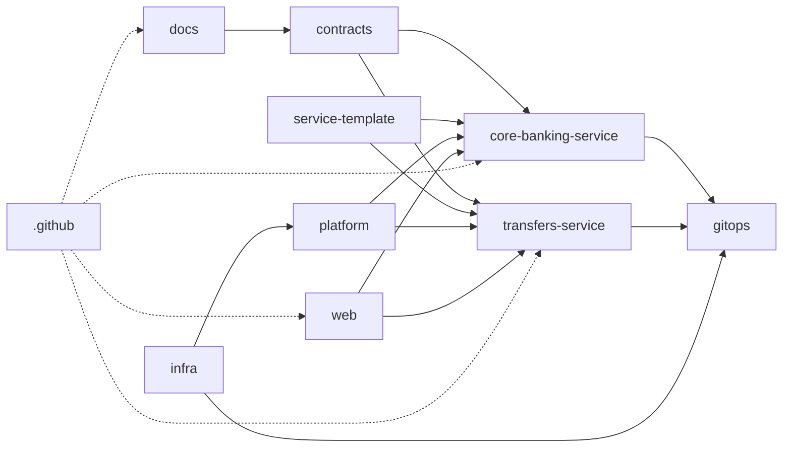

# Mapa de repositorios de la organización

> Organización propuesta: `vela-bank` `[PROPUESTO]`. Todos los nombres son provisionales hasta
> confirmación.

## 1. Principio

Cada repositorio debe tener un propósito, un owner y un ciclo de vida claros. No se crea un repo
“porque sí”: si no tiene contenido, owner o pipeline propio, todavía no debe existir.

## 2. Repositorios iniciales

| Repo | Tipo | Propósito | Owner | Contenido clave |
| --- | --- | --- | --- | --- |
| `.github` | Gobierno de org | Perfil, plantillas y workflows compartidos | `platform` | `profile/README.md`, `CONTRIBUTING.md`, `SECURITY.md`, `ISSUE_TEMPLATE/`, `PULL_REQUEST_TEMPLATE.md`, reusable workflows |
| `docs` | Documentación | Fuente de verdad del proyecto | `platform` | Visión, alcance, arquitectura, ADRs, dominio, runbooks |
| `contracts` | Contratos | OpenAPI, AsyncAPI/JSON Schema, Pact | `platform` + servicios | Especificaciones versionadas, breaking-change checks |
| `platform` | Plataforma local | Experiencia de desarrollo y addons | `platform` | Docker Compose, Floci, Keycloak, kind, Argo CD, observabilidad, Tilt, seed, E2E |
| `service-template` | Template | Esqueleto estándar de servicio | `platform` | Spring Boot, Dockerfile, Helm, CI, tests, OpenAPI, Renovate |
| `core-banking-service` | Microservicio | Clientes, cuentas, ledger, saldos | `core-banking` | Código, migraciones, contrato interno, eventos |
| `transfers-service` | Microservicio | Transferencias, idempotencia, orquestación | `payments` | Código, migraciones, contrato, outbox |
| `gitops` | CD | Estado declarativo de despliegue | `platform` | Argo CD, ApplicationSets, values por entorno, digests |
| `infra` | IaC | Infraestructura AWS y organización GitHub | `platform` | Terraform/OpenTofu, módulos, entornos, org as code |
| `web` | Frontend | App cliente + backoffice | `frontend` | React/TypeScript, dos apps, OIDC PKCE, E2E |

## 3. Repositorios posteriores

| Repo | Cuándo crearlo | Propósito |
| --- | --- | --- |
| `admin` | Cuando backoffice tenga equipo/permisos propios | App separada de backoffice. |
| `e2e` | Cuando los tests cruzados no caben en `platform` | Suite E2E/API contra staging. |
| `ui` | Cuando el design system se comparta de verdad | Componentes y tokens compartidos. |
| `notifications-service` | Cuando notificaciones sea un dominio propio | Email/SMS/push. |
| `ledger-service` | Solo si core banking se vuelve inmanejable | Extracción del ledger. |
| `org` | Si el Terraform de GitHub crece | Org as code separado de `infra`. |
| `data` | Cuando haya analytics/reporting real | Pipelines de datos. |
| `sandbox` | Para experimentos descartables | Pruebas sin compromiso. |

## 4. Grafo de dependencias

## 5. Ownership

| Equipo | Repos |
| --- | --- |
| `platform` | `.github`, `docs`, `contracts`, `platform`, `service-template`, `gitops`, `infra` |
| `core-banking` | `core-banking-service` |
| `payments` | `transfers-service` |
| `frontend` | `web`, `admin` |
| `security` | Revisión transversal de cambios sensibles |

Para un proyecto unipersonal, los equipos pueden ser placeholders, pero `CODEOWNERS` debe existir
igual: deja el modelo listo y fuerza revisión en áreas sensibles.

## 6. Convenciones de nombres

- Servicios: `<dominio>-service`, en kebab-case.
- Frontends: `web`, `admin`, `ui`.
- Plataforma: `platform`, `infra`, `gitops`, `contracts`.
- Documentación: `docs`.
- Templates: `<tipo>-template`.
- Ramas: `feat/<slice>-<slug>`, `fix/<slug>`, `docs/<slug>`, `chore/<slug>`, `ci/<slug>`.
- Tags: `v<major>.<minor>.<patch>` por repo.

## 7. Qué no crear

- `common`, `commons`, `utils`, `shared`: acoplan servicios y esconden dependencias.
- `bank-core`: nombre ambiguo; no dice qué dominio posee.
- Un repo por capa técnica (`controllers`, `models`): eso es un monorepo disfrazado.
- Un repo por microservicio futuro antes de tener dominio y owner.
- Un repo de secretos. Los secretos van a un gestor, nunca a Git.

## 8. Migración del repo actual

El repo actual (`bank`) se convertirá en `docs`:

1. Crear la organización.
2. Transferir el repo.
3. Renombrarlo a `docs`.
4. Mover `CONTRIBUTING.md` y `SECURITY.md` al repo `.github`.
5. Dejar en `docs` la arquitectura, ADRs, dominio y runbooks.
6. Actualizar el remoto local y los enlaces.

GitHub mantiene redirecciones después del rename/transfer, pero conviene actualizar los remotos y
la documentación.

## 9. Orden de creación

1. `.github`
2. `docs` (migración del actual)
3. `contracts`
4. `platform`
5. `service-template`
6. `core-banking-service`
7. `transfers-service`
8. `gitops`
9. `infra`
10. `web`

Ver [gobierno de la organización](../governance/org-setup.md) para permisos, rulesets y
workflows.
