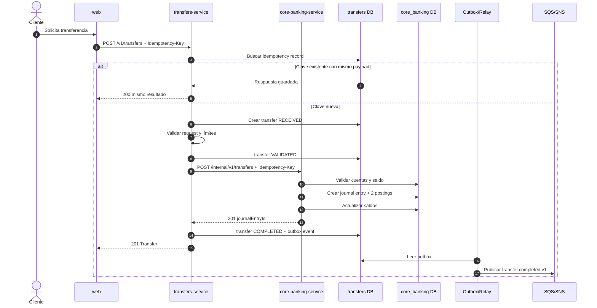
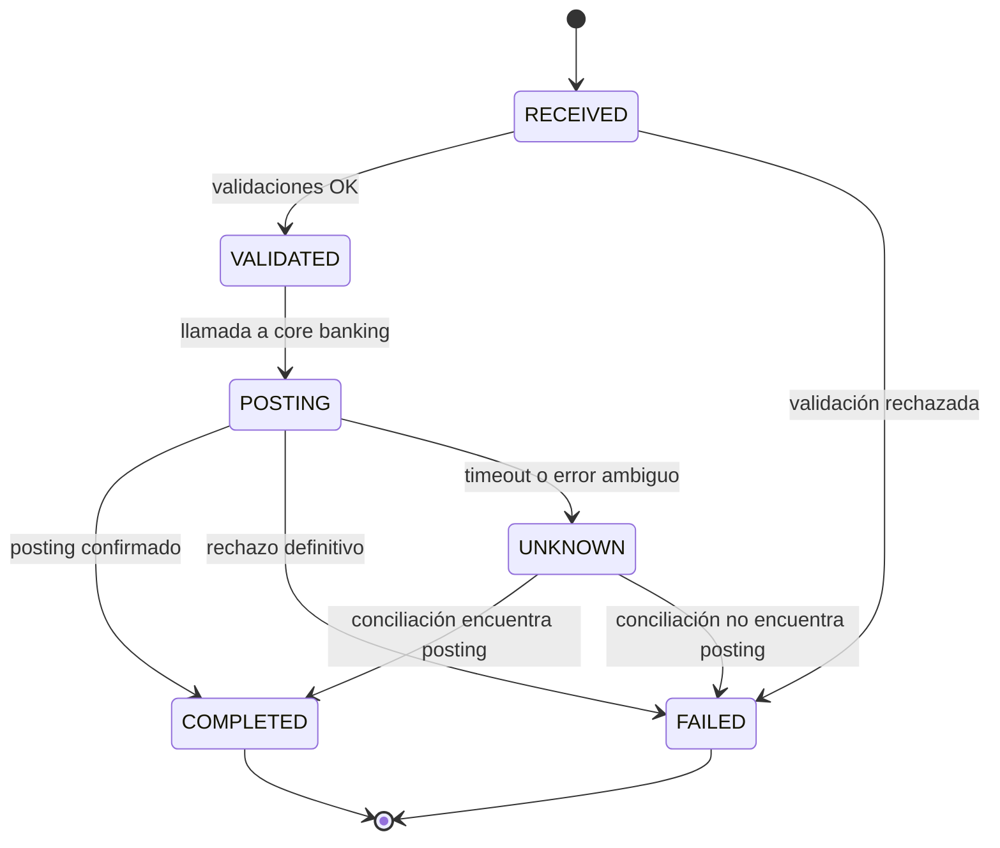

# Flujo de transferencia

## 1. Alcance

Transferencia interna entre dos cuentas del mismo banco, en la misma moneda, con idempotencia y
trazabilidad completa. Las transferencias externas quedan para una fase posterior.

## 2. Actores

- Cliente autenticado en `web`.
- `transfers-service`.
- `core-banking-service`.
- Keycloak.
- SQS/SNS (Floci en local).
- Base de datos `transfers`.
- Base de datos `core_banking`.

## 3. Precondiciones

- El cliente está autenticado.
- La cuenta origen pertenece al cliente.
- Ambas cuentas están `ACTIVE`.
- La moneda coincide.
- El monto es positivo y respeta límites.
- La solicitud incluye `Idempotency-Key`.

## 4. Secuencia

## 5. Pasos detallados

1. **Recepción.** `transfers-service` valida el JWT, el `Idempotency-Key` y el payload.
2. **Idempotencia.** Busca `(customer_id, idempotency_key)`. Si existe:
   - mismo hash de request → devuelve la respuesta guardada;
   - hash distinto → `409 Conflict`.
3. **Persistencia inicial.** Crea `Transfer` en `RECEIVED` con `correlation_id`.
4. **Validación.** Verifica cuentas distintas, moneda, monto, límites de canal y estado.
5. **Posting.** Llama a `core-banking-service` con la misma clave de idempotencia.
6. **Core banking.** En una transacción:
   - bloquea/valida la cuenta origen;
   - verifica saldo disponible;
   - crea `JournalEntry`;
   - crea dos `Posting` (débito y crédito);
   - actualiza saldos;
   - registra auditoría.
7. **Confirmación.** `transfers-service` marca `COMPLETED` y guarda el `journalEntryId`.
8. **Outbox.** En la misma transacción del paso 7, inserta `transfer.completed.v1`.
9. **Respuesta.** Devuelve `201` con el recurso.
10. **Publicación.** El relay lee el outbox y publica a SQS/SNS.
11. **Consumo.** Consumidores idempotentes procesan el evento.

## 6. Máquina de estados

`UNKNOWN` es un estado de primera clase. No se debe asumir fallo ante un timeout.

## 7. Idempotencia

### Pública

- Header obligatorio `Idempotency-Key`.
- Única por `(customer_id, idempotency_key)`.
- Se guarda el hash canónico del request.
- Misma clave + mismo payload → misma respuesta.
- Misma clave + payload distinto → `409`.
- Retención mínima: 24 horas; recomendable 7 días.

### Interna

- `core-banking-service` aplica idempotencia por la misma clave.
- Única por `idempotency_key`.
- Devuelve el mismo `journalEntryId` en un reintento.
- Si el asiento ya existe, no crea otro.

## 8. Matriz de fallos

| Fallo | Detección | Acción | Estado final |
| --- | --- | --- | --- |
| Saldo insuficiente | Core banking `422` | No reintentar; informar al cliente | `FAILED` |
| Cuenta congelada | Core banking `422` | No reintentar; informar | `FAILED` |
| Timeout de core banking | Sin respuesta | Reintentar misma clave; si persiste, `UNKNOWN` | `UNKNOWN` |
| Core banking 5xx | Error transitorio | Reintento con backoff y misma clave | `UNKNOWN`/`COMPLETED` |
| Caída después del commit, antes de respuesta | Timeout | Conciliar por clave | `COMPLETED` |
| Falla el outbox | Evento no publicado | Relay reintenta | `COMPLETED` |
| Duplicado de request | Clave existente | Devolver respuesta guardada | Igual al original |
| Payload distinto con misma clave | Hash distinto | `409` | Sin cambio |

## 9. Conciliación

Job programado en `transfers-service`:

1. Busca transferencias en `POSTING` o `UNKNOWN` con más de N segundos.
2. Consulta `GET /internal/v1/transfers/{idempotencyKey}` en core banking.
3. Si existe el posting → marca `COMPLETED`.
4. Si no existe y el plazo expiró → marca `FAILED`.
5. Registra evidencia y emite evento.
6. Alerta si la tasa de `UNKNOWN` supera el umbral.

## 10. Seguridad y auditoría

- El cliente solo puede transferir desde cuentas propias.
- El token de servicio tiene scope `internal:transfers`.
- El endpoint interno no se expone por ingress.
- Se registra: actor, cuentas, monto, moneda, correlation ID, timestamps, estado y motivo de fallo.
- No se registran datos sensibles innecesarios.
- Cada transición de estado deja auditoría inmutable.

## 11. Casos de prueba

- [ ] Transferencia exitosa entre dos cuentas activas.
- [ ] Transferencia con saldo insuficiente.
- [ ] Transferencia desde cuenta congelada.
- [ ] Transferencia a la misma cuenta.
- [ ] Monedas distintas.
- [ ] Reintento con misma clave y mismo payload.
- [ ] Reintento con misma clave y payload distinto.
- [ ] Timeout de core banking con posting exitoso.
- [ ] Timeout de core banking sin posting.
- [ ] Falla de publicación de evento y reintento del outbox.
- [ ] Conciliación de `UNKNOWN`.
- [ ] Verificación de asiento balanceado.

## 12. Fuera de alcance

- Transferencias externas y redes de pago.
- Multi-moneda y FX.
- Transferencias programadas.
- Límites por riesgo/fraude avanzados.
- Reversos automáticos por fraude.
