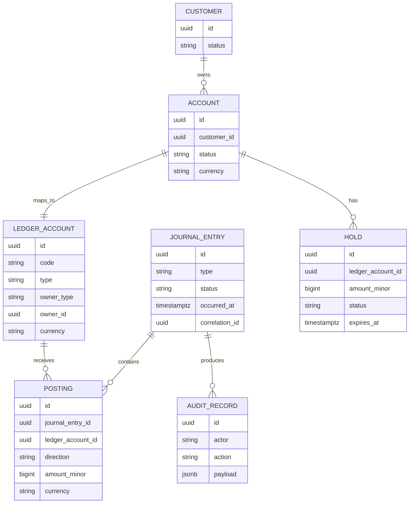

# Ledger de doble entrada

## 1. Principio

El ledger es la fuente de verdad del dinero. Los saldos se derivan de asientos contables
inmutables. Nunca se actualiza ni se borra un asiento: los errores se corrigen con un reverso.

## 2. Modelo de datos



## 3. Entidades

| Entidad | Campos clave | Reglas |
| --- | --- | --- |
| `ledger_account` | `id`, `code`, `type`, `owner_type`, `owner_id`, `currency` | Una cuenta por cliente/moneda; cuentas internas para contrapartida. |
| `journal_entry` | `id`, `type`, `status`, `occurred_at`, `correlation_id` | Inmutable una vez `POSTED`. |
| `posting` | `id`, `journal_entry_id`, `ledger_account_id`, `direction`, `amount_minor`, `currency` | Inmutable; monto positivo. |
| `account_balance` | `ledger_account_id`, `available_minor`, `held_minor`, `version` | Se actualiza con lock optimista; se reconcilia contra postings. |
| `hold` | `id`, `ledger_account_id`, `amount_minor`, `status`, `expires_at` | Reserva fondos sin moverlos. |
| `audit_record` | `id`, `actor`, `action`, `payload`, `created_at` | Append-only. |

## 4. Invariantes

1. Para todo `journal_entry`: `sum(debits) == sum(credits)`.
2. Todo `posting.amount_minor > 0`.
3. La moneda del posting coincide con la del journal entry y la cuenta.
4. Un `journal_entry` en estado `POSTED` no se modifica ni se elimina.
5. Un reverso crea un nuevo `journal_entry`; no cambia el original.
6. `available_minor = posted_balance - held_minor`.
7. No se permite saldo negativo salvo que el producto lo habilite explícitamente.
8. Toda cuenta de cliente tiene una contrapartida interna (cash/suspense).
9. La suma de postings de una cuenta es reconstruible en cualquier momento.
10. La reconciliación detecta y alerta cualquier diferencia entre saldo y postings.

## 5. Dinero

- Se representa como **entero en unidades menores** (`amount_minor`) + código ISO 4217.
- Nunca usar `float` ni `double`.
- Ejemplo: COP 12.500,00 → `{ "amountMinor": 1250000, "currency": "COP" }`.
- Las operaciones aritméticas se hacen en enteros; el redondeo se define por producto.

## 6. Ejemplos

### 6.1 Depósito de COP 100.000

| Cuenta | Dirección | Monto |
| --- | --- | --- |
| `CASH` (interna) | Débito | 10000000 |
| Cuenta del cliente | Crédito | 10000000 |

### 6.2 Transferencia de COP 30.000 de A a B

| Cuenta | Dirección | Monto |
| --- | --- | --- |
| Cuenta A | Débito | 3000000 |
| Cuenta B | Crédito | 3000000 |

### 6.3 Reverso de la transferencia

| Cuenta | Dirección | Monto |
| --- | --- | --- |
| Cuenta B | Débito | 3000000 |
| Cuenta A | Crédito | 3000000 |

El reverso referencia el `journal_entry` original y registra motivo, actor y aprobación.

## 7. Holds

- Se crean antes de una operación que aún no se confirmó (por ejemplo, transferencia externa).
- Reducen `available_minor`, no el saldo contable.
- Estados: `ACTIVE`, `CAPTURED`, `RELEASED`, `EXPIRED`.
- Se pueden capturar (convertir en posting) o liberar.
- Tienen expiración y job de limpieza.
- Son idempotentes por clave.

## 8. Concurrencia

- El posting se ejecuta en una transacción de base de datos.
- Se bloquea la cuenta origen con `SELECT ... FOR UPDATE` o lock optimista con `version`.
- Se usa aislamiento `READ COMMITTED` con locks explícitos, o `SERIALIZABLE` con reintento.
- Ante conflicto de serialización, se reintenta la operación completa.
- La idempotencia evita que un reintento cree un segundo asiento.
- El orden de bloqueo de cuentas es determinístico para evitar deadlocks.

## 9. Idempotencia

- `journal_entry` tiene `idempotency_key` único.
- Si llega la misma clave:
  - mismo payload → devolver el mismo resultado;
  - payload distinto → `409 Conflict`.
- El `idempotency_key` se guarda junto con un hash canónico del request.
- La retención mínima es 24 horas; recomendable 7 días.

## 10. Reconciliación

Job periódico:

1. Suma postings por cuenta.
2. Compara con `account_balance.posted_minor`.
3. Compara `available_minor` con `posted_minor - held_minor`.
4. Verifica que cada journal entry esté balanceado.
5. Reporta diferencias con `correlation_id` y cuenta.
6. Alerta si hay diferencias; no corrige automáticamente sin aprobación.

## 11. Auditoría

- Cada `journal_entry` registra actor, origen, correlation ID y timestamps.
- Cada transición de estado deja un `audit_record` append-only.
- Los logs de aplicación no reemplazan la auditoría.
- La auditoría se exporta a almacenamiento inmutable (S3 con object lock en producción).
- Se puede reconstruir una operación desde el evento, el asiento y la auditoría.

## 12. Esquema SQL de referencia

```sql
create table ledger_accounts (
  id uuid primary key,
  code text not null unique,
  type text not null check (type in ('ASSET','LIABILITY','EQUITY','INCOME','EXPENSE')),
  owner_type text not null check (owner_type in ('CUSTOMER','INTERNAL')),
  owner_id uuid,
  currency char(3) not null,
  created_at timestamptz not null default now()
);

create table journal_entries (
  id uuid primary key,
  type text not null,
  status text not null check (status in ('POSTED','REVERSED')),
  occurred_at timestamptz not null,
  correlation_id uuid not null,
  idempotency_key text not null unique,
  request_hash text not null,
  description text,
  created_at timestamptz not null default now()
);

create table postings (
  id uuid primary key,
  journal_entry_id uuid not null references journal_entries(id),
  ledger_account_id uuid not null references ledger_accounts(id),
  direction text not null check (direction in ('DEBIT','CREDIT')),
  amount_minor bigint not null check (amount_minor > 0),
  currency char(3) not null,
  created_at timestamptz not null default now()
);

create table account_balances (
  ledger_account_id uuid primary key references ledger_accounts(id),
  posted_minor bigint not null default 0,
  held_minor bigint not null default 0,
  version bigint not null default 0,
  updated_at timestamptz not null default now()
);
```

## 13. Tests obligatorios

- [ ] Todo asiento está balanceado.
- [ ] No se puede crear un posting con monto ≤ 0.
- [ ] No se puede modificar un asiento `POSTED`.
- [ ] Un reverso deja el saldo original.
- [ ] Un hold reduce disponible pero no contable.
- [ ] Un reintento idempotente no duplica postings.
- [ ] La suma de postings coincide con el saldo.
- [ ] No se permite transferir sin saldo.
- [ ] El orden de bloqueo evita deadlocks.
- [ ] La reconciliación detecta una diferencia inyectada.

## 14. Fuera de alcance

- Intereses y devengamientos.
- Multi-moneda y FX.
- Derivados y productos de inversión.
- Contabilidad fiscal y reportes regulatorios.
